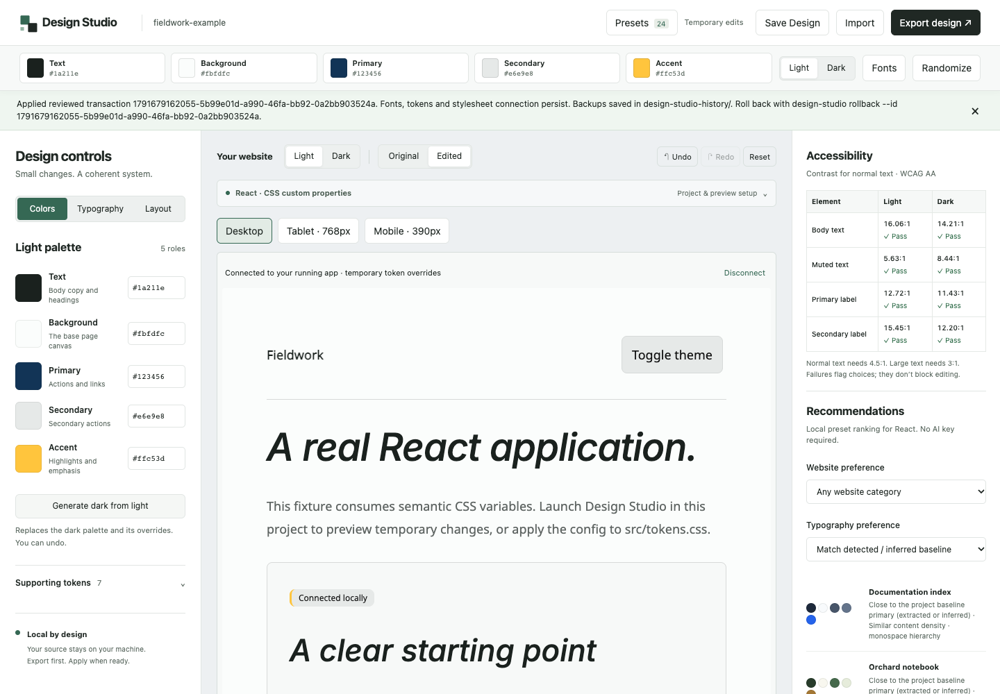

# Design Studio


Design Studio is a local browser editor for **existing frontend projects**. Run its CLI in a website directory, inspect the project, preview temporary design changes, save a selection, and review a persistent Apply. Colors, typography, presets, recommendations, prompts and exports work without an AI API key.



After the one-time global installation below, launch from your website:

```sh
cd my-website
design-studio
```

## Current status

This is an early, locally installable release. Automatic actual-project preview and persistent font application support **React + Vite + index.html**; color editing uses supported CSS variables or explicitly selected CSS migrations. The adapter preserves existing layout, functionality, unrelated rules and local edits. A CSS-only adapter remains available for platform-font configurations in other projects; it does not connect styles automatically. Next.js, Vue, Svelte, CSS-in-JS and complex conditional token cascades do not have persistent font adapters.

The executable is `design-studio`; the package name is `design-studio-workspace`. **This project is not published to npm.** The npm registry contains an unrelated `design-studio` package, so do not use `npx design-studio`. `npm view design-studio-workspace name version --json` returned E404 (not found) on 2026-10-11. This is a candidate for a future registry release, not a reserved name or a guarantee that npm will accept it; recheck availability before publishing. The package remains private.

Node.js **22.12 or newer** is required. The CLI uses platform-neutral Node/Vite APIs and browser-opening commands for macOS, Linux and Windows. Validation here uses macOS arm64, Node 24.11.1 and Chrome; the existing packed-CLI CI also covers Linux and Windows; browser rendering on those platforms is not verified here. Use `--no-open` if automatic browser opening is unavailable.

## One-time installation

In the Design Studio checkout, build a local tarball:

```sh
npm ci
npm pack
```

`npm pack` builds the editor and CLI and creates `design-studio-workspace-0.1.0.tgz`. Install that exact tarball globally, outside your website:

```sh
npm install --global "/absolute/path/to/design-studio-workspace-0.1.0.tgz"
```

Ensure npm's global executable directory is on your terminal's PATH (`npm config get prefix`: `bin` under that prefix on macOS/Linux, the prefix itself on Windows). If the default prefix needs administrator permissions, use a user-owned prefix on macOS/Linux:

```sh
npm install --global --prefix "$HOME/.local" "/absolute/path/to/design-studio-workspace-0.1.0.tgz"
export PATH="$HOME/.local/bin:$PATH"
```

Keep that PATH export in your shell startup file for future terminals. Run `design-studio --help` to confirm installation. Global tarball installation was verified with a separate temporary prefix and PATH on macOS; the website did not receive a Design Studio dependency. No npm publication is required.

## Everyday usage

Open a terminal inside your existing website:

```sh
cd my-website
design-studio
```

The editor opens automatically at `http://127.0.0.1:4310`; supported React/Vite projects preview at port 4311. Startup prints the resolved project path, editor URL and preview status. Both servers bind to loopback. Bundled editor assets and fonts resolve relative to the installed tool, independently of your current directory.

Explicit launch commands and options remain available:

```sh
design-studio dev
design-studio --no-open
design-studio --port 4410
design-studio --project "/path/to/my website"
design-studio --help
```

`--port` selects two consecutive ports: the editor at that port, preview at the next. If the editor port is occupied, startup fails with instructions to choose a free pair. If the preview port is occupied or website dependencies are missing, the editor remains available and prints the reason and remedy; actual-project preview is unavailable until you fix the issue and restart. Browser-launch failure prints the URL to open manually; `--no-open` suppresses launch.

Install your website's own dependencies using its package manager before starting (for npm projects, `npm ci` with a lockfile or `npm install`). Design Studio never installs them automatically and never adds itself to your website's manifest. Quoted paths containing spaces are supported.

For development from the tool checkout only:

```sh
npm install --prefix examples/react-css-vars
npm run cli -- dev --project "./examples/react-css-vars"
```

That first command explicitly installs the example website's dependencies; everyday usage needs only `design-studio`.

## Typical workflow

1. **Launch and inspect.** Open your project's actual website where supported. Preview failures show the concrete reason and recovery steps. A sample page appears only after explicitly choosing **Show representative preview**.
2. **Customize.** Select a preset or recommendation; edit colors, heading/body fonts, typography scale, spacing and radius. Compare Original/Edited, choose desktop/tablet/mobile preview sizes, and use undo, redo or reset. Changes remain temporary.
3. **Save and reopen.** Save Design creates an append-only named version in `design-workspace/`. Reopen it through the same dialog. Preset provenance, pinned font variants and custom changes are retained. Unsaved browser edits are lost on reload.
4. **Review.** Apply to Project shows every proposed text diff, binary asset hash and file path. Review downloads required fonts into the tool's cache but writes no website files. Reviews expire after ten minutes; changed files require a new review.
5. **Apply explicitly.** React/Vite Apply updates tokens, connects the stylesheet in `index.html`, adds selected typography rules, and self-hosts the selected fonts and notices under `design-studio-assets/`. It does not install dependencies. Your website keeps these changes when Design Studio is closed.
6. **Roll back when needed.** Use the commands below. Backups of modified files and records of created files remain in `design-studio-history/`. Rollback refuses to overwrite edits made after Apply.

The CLI supports the same plan and transaction logic:

```sh
# From your website, after the one-time global installation.
design-studio inspect
design-studio apply --config ./design.config.json --target ./src/tokens.css --dry-run
design-studio apply --config ./design.config.json --target ./src/tokens.css
design-studio history
design-studio rollback --id <printed-transaction-id> --dry-run
design-studio rollback --id <printed-transaction-id>
```

Leave out `--target` to introduce a managed `design.tokens.css` layer. Its repeated scope selectors outrank ordinary project token declarations regardless of Vite import order, matching the temporary preview. An existing unmanaged default filename is refused. For a supported React/Vite project, the stylesheet is connected automatically. Mapped root/body tokens can use `.dark`, `html.dark`, `body.dark` or supported `data-theme="dark"` selectors, including unconditional `@layer` blocks. A manually selected `.design-scope` remains available. The configuration retains the detected theme selector and each token’s color encoding. Conditional/important rules and mixed scopes require manual integration. Components must consume mapped variables; **Map project colors** can also migrate individually selected hardcoded CSS declarations. Review lists those source edits and refuses stale or ambiguous declarations; unrelated colors remain untouched.

### Failure recovery and rollback

Apply stages files before replacing them, checks every reviewed file again, uses a project lock and saves before/after bytes with SHA-256 checks. Caught write failures restore files already changed, unless conflicting concurrent edits would be overwritten. A multi-file filesystem change is not a single OS-atomic operation: an abrupt power loss or process kill can leave a **prepared** record. New Apply operations refuse to continue until it is recovered:

```sh
design-studio history
design-studio recover --id <interrupted-transaction-id>
```

Recovery restores files that match the recorded before/after bytes and refuses unknown edits. Never delete history before checking whether it contains an interrupted transaction. Backups contain project source; keep `design-studio-history/` out of Git and do not upload it with bug reports. Add `design-workspace/` to your project's ignore file if saved designs contain private project details. Application resources under `design-studio-assets/` **should** be committed in the target website when you want to keep the applied design.

## Design controls

**Map project colors** connects detected CSS variables (such as `--primary`) to Text, Background, Primary, Secondary and Accent. The mapping is retained in saves, prompts, CSS/Skill exports and Apply. Current design colors are kept unless you explicitly choose detected Light/Dark values. Common names such as `--primary`, `--background`, `--foreground` and `--color-primary` are inferred when unambiguous. The preview reports visible consumers and computed-color matches; existence in a file alone is not a successful connection. Missing or overridden consumers receive a diagnosis. Opaque short/six-digit HEX, RGB, HSL, OKLCH and HSL/RGB channels are supported; channels keep their semantics in preview, exports and Apply. Alpha, expressions, conditional/other selectors and `!important` are flagged for manual integration.

The persistent toolbar exposes **Text, Background, Primary, Secondary, Accent, Light/Dark, Fonts and Randomize**. Light and Dark palettes are independent. Supporting surface, muted, border, label, hover and focus tokens are derived unless overridden. Contrast results flag failing combinations without silently replacing user values.

Heading and body fonts have separate weights, styles and optional variable weight axes. An optional typography scale computes `h1 = baseSize × scale⁵` through `h6 = baseSize`, exporting exact pixel sizes. An unselected scale preserves project heading sizes; heading line heights and layout remain unchanged. Very large selected sizes can overflow a narrow existing layout: use the real mobile preview before Apply.

The searchable preset registry contains 24 original compositions assembled from the licensed resources listed below. Recommendations use local deterministic ranking against detected/inferred project values and your preferences, with a short reason for each result.

Randomize offers monochromatic, analogous, complementary and triadic schemes. It changes only the active theme and preserves locked roles and supporting overrides. Font pairings have separate heading/body category filters, full-variant locks and a verified Kazakh/Russian filter for unlocked choices. Starter pairings work offline; opt into the Fontsource catalog for more families. Locks can prevent readable combinations, so check both themes' contrast results.

## Fonts, downloads and language coverage

The metadata catalog contains 2,100 Fontsource families, with family search, category/verified-language filters, favorites and editable sample text. Visible rows are virtualized. The whole library is not downloaded. Cached samples load locally; downloading a new family or variant requires the opt-in sample control or an explicit selection. Reopening a saved pinned selection may need a download on a new machine.

Noto Sans and Noto Serif starter assets are bundled. Their actual Latin/Cyrillic/Cyrillic-ext cmap tables have been checked for complete English, Russian and Kazakh alphabets, separately at weights 400 and 700 normal, including **Ә, Ғ, Қ, Ң, Ө, Ұ, Ү, Һ, І**. The verification script and file hashes are in `scripts/verify-fonts.py` and `src/registry/data/font-coverage.json`. Catalog names and subset labels do not prove glyph coverage. Other catalog choices display **Language coverage not verified**.

The interface reports download-required, loading, loaded and failed states. A failed reopened font keeps its selected configuration, uses a real fallback stack and offers **Retry selected font** / **Retry preview fonts**. Failed samples offer Retry sample. Failure never means the intended font loaded simply because a fallback rendered.

Fontsource variants are fetched from `registry.npmjs.org` and `cdn.jsdelivr.net`, pinned to exact package versions, cached with SHA-256 asset checks, and retain license/copyright text. Previously downloaded variants work without external network access while the local CLI is running. `DESIGN_STUDIO_FONT_CACHE` overrides the cache directory. `TOKEN_STUDIO_FONT_CACHE` is still accepted; an existing legacy cache is reused when the new default `~/.cache/design-studio/fonts` does not exist.

React/Vite Apply includes only the selected weights/styles and variable-font settings, using self-hosted WOFF2 assets plus declarations and imports. Identical assets are reused; existing font declarations are preserved. No dependency installation or manifest change is hidden in Apply. Automatic redistribution accepts verified OFL, Apache or MIT font license texts; unrecognized licenses require a manual licensing review. Edited generated resource files are refused rather than overwritten. Unused files from an earlier selection may remain on disk; rollback tracks the actual changed/created files.

## Project inspection, live preview and privacy

Inspection reads local `package.json`, bounded CSS files and component filenames. It extracts opaque numeric CSS colors and records supported theme selectors, formats, package scripts and individual hardcoded CSS colors. Unmatched colors and typography are labeled as inferred defaults. Limits: six directory levels, 1,500 entries, 80 CSS files, 120 colors and 1 MB per inspected file.

Dependencies, hidden files (including environment files), build directories, symlinks, saved designs, apply backups and generated resource folders are excluded. Inspection never executes source code. The **automatic preview does run the project's local Vite configuration**, as a normal local development server would; only use it with projects you trust. Install your website dependencies yourself. Preview uses the website’s installed Vite, configuration, plugins, aliases, base and environment handling; a configured frontend root inside the package is retained for Apply. A monorepo with one React/Vite package is resolved automatically; multiple packages produce explicit `--project` choices instead of guessing. Saved versions and Apply history belong to the resolved frontend folder. For subsequent CLI apply/export/history/recovery commands from a monorepo parent, use `--project` with the resolved website folder printed at startup (the rollback message includes it). Tool assets always resolve relative to its installed module, never the website directory. Automatic Vite preview does not require a `dev` script; the independent example includes one for normal development.

The preview bridge and selected CSS are injected in memory. They change fonts/tokens and the preview theme without writing source. Original comparison removes temporary overrides and restores the initial theme/class state. The handshake reconnects after iframe navigation; temporary CSS stays after HMR-injected styles. Fonts load inside the website frame as well as the editor. Inspection retains an existing managed design’s configuration and provenance. Unselected typography and layout stay unchanged; a font/type control, layout control or preset selects the corresponding settings. Color-only Apply preserves existing font imports, assets, notices, spacing and radius. Browser diagnostics sample up to 200 matching elements and twelve alias hops; shadow DOM, inaccessible external stylesheets, and complex conditional cascades require manual verification. Edited numeric colors are represented in sRGB, so out-of-gamut OKLCH values may be clipped. Other local apps can opt into the origin-checked cooperative bridge shown in Project & preview setup; frame policy and token consumption still apply. Public URL analysis is not implemented.

There is no AI API integration, telemetry, source upload or hosted backend in this implementation. Recommendations and English implementation prompts use deterministic local templates. External requests are limited to opted-in/selected Fontsource downloads and the normal npm dependency installation you run explicitly. The user's website can make its own requests; Design Studio does not intercept or upload that traffic. Editor/API services bind to loopback, reject foreign origins for mutations and require same-origin JSON.

## Exports

- **Configuration:** plain schema-v1 `design.config.json`, or named version envelopes through Save Design. Older configs remain valid.
- **CSS:** both themes, semantic variables, typography and selected scale rules; optional Tailwind mapping, SCSS, shades and gradients.
- **Generate Prompt:** readable, self-contained English prompt containing only the selected design, exact tokens/type values, inspected project paths, accessibility, theme behavior and preservation instructions. Copy or download it as text; no model call.
- **Export Agent Skill:** ZIP/folder containing `SKILL.md`, config, CSS, selected fonts, provenance, complete licenses and notices. All referenced assets travel with the export.

```sh
design-studio export-skill --config ./design.config.json --out ./my-design-skill
design-studio presets --category editorial --language kk --limit 5
```

Skill export refuses to overwrite an existing folder. The registry router is documented in `registry-router-SKILL.md`.

## Open-source resources and inspiration

Original project code and compositions retain the existing [MIT license](LICENSE). Third-party materials retain their own licenses; no upstream source is renamed or relicensed. See [THIRD_PARTY_NOTICES.md](THIRD_PARTY_NOTICES.md) for exact versions, sources, copied/adapted paths, full license links, software transitives and platform-conditional verification limits.

| Resource | Purpose | License |
| --- | --- | --- |
| React / React DOM / scheduler | Browser editor, bundled | MIT |
| Vite / PostCSS and runtime dependencies | Local serving/build and CSS parsing | See versioned dependency notices |
| UI UX Pro Max | Selected palette/style rows, adapted | MIT |
| Anthropic Frontend Design | Selected design guidance, adapted | Apache-2.0 |
| Radix Colors / daisyUI / Open Props | Selected color, theme, spacing/radius data, adapted | MIT |
| Fontsource Noto Sans / Noto Serif | Bundled starter assets | OFL-1.1 |
| Fontsource API | Metadata catalog; additional assets on demand | Font licenses are package-specific |

[Realtime Colors](https://www.realtimecolors.com/) is **UX inspiration**, separately from imported open-source resources. Repository inspection found no imported Realtime Colors code or artwork; its source and visual assets are not redistributed. Design Studio has its own interface and actual-project workflow. The legacy SVG wordmark and inline icons are original project code. The current PNG logo is user-supplied artwork copied unchanged to `public/design-studio-logo.png`; `public/design-studio-favicon.png` is a separate emblem crop. Both are included in the built editor and packaged CLI. Their origin and license have not been documented; no license claim is made for these images. The workspace screenshot above predates this logo update and shows the legacy wordmark.

## Architecture and development

- `src/cli`: inspection, loopback servers, selected-font cache, project apply planner and recoverable transactions.
- `src/web`: React editor, history, controls, previews and save/export/review dialogs.
- `src/shared`: validated configuration, semantic tokens, font metadata, deterministic prompts and exports.
- `src/registry`: pinned source registry and original preset compositions.
- `dist` / `dist-cli`: built editor and executable; included in the local tarball.

See [architecture](docs/architecture.md), [release validation results](docs/validation.md) and [preset contribution instructions](docs/presets.md).

```sh
npm test
npm run typecheck
npm run build
npm run registry:validate
node scripts/dependency-notices.mjs
npm pack
```

Glyph re-verification needs Python with `fonttools` and `brotli`, then `python scripts/verify-fonts.py`. These are verification tools, not application dependencies.

See [CONTRIBUTING.md](CONTRIBUTING.md). Bug reports should include Node/OS versions, the exact command/flow, expected/actual behavior and a small sanitized fixture. Do not attach secrets, private source, font caches or recovery backups. Issue templates are in `.github/ISSUE_TEMPLATE/`.

## Known limitations and roadmap

Automatic persistent integration is currently React/Vite with supported CSS variables or individually selected opaque CSS color migrations. Fonts with unrecognized redistribution licenses need manual review. Apply leaves unrelated declarations and previous unused resources intact; it does not install packages, restructure layout or rewrite arbitrary component colors. Rollback refuses conflicts and crash recovery requires an explicit command. The browser bundle currently produces a Vite size warning; catalog code splitting is future work. The existing three-platform CI checks the packed CLI; current workflow browser verification is macOS/Chrome only. Additional adapters remain future work, followed by a `design-studio-workspace` npm release after availability/ownership are rechecked. No npm release or hosted deployment is part of this preparation.
